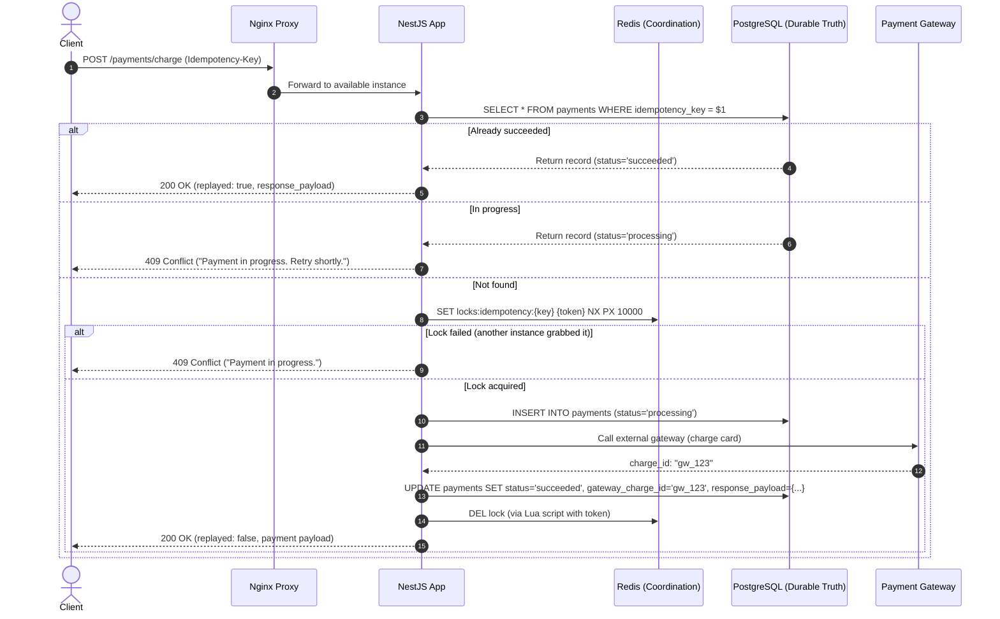

# 01 — Idempotency Failure in Multi-Instance Payments

## Phase Status

This phase contains both the broken implementation and the production-grade fix. Run the broken endpoint first, reason about the failure, then compare it with the durable implementation.

## Folder Structure

```text
src/
  app.module.ts
  database/
    database.module.ts       <-- Native pg Pool (PG_POOL token)
  payment/
    broken-payment.store.ts  <-- In-memory Map (demonstrates process-local flaw)
    dto/
      create-broken-payment.dto.ts
      create-payment.dto.ts
    payment.controller.ts
    payment.module.ts
    payment-record.ts
    payment.service.ts       <-- Raw PostgreSQL + Redis coordination
    redis-lock.service.ts    <-- Distributed lock via SET NX PX
db/
  init/
    001_schema.sql           <-- payments table with UNIQUE constraints
docker-compose.yml           <-- PostgreSQL 17 + Redis 7 + App
nginx.conf                   <-- Reverse proxy simulating multi-instance traffic
docs/
  01-idempotency.md
```

---

## Problem Scenario

A customer taps "Pay" in a mobile app. The network times out before the client receives the response, so the app retries the same payment request with the same `Idempotency-Key`.

In production, the NestJS API runs behind Nginx with multiple app instances. Request 1 lands on container A, and the retry lands on container B. If each instance only checks local memory, both containers believe they are processing the first payment and both call the payment gateway.

**Real outcome:** Duplicate credit card charge, angry customer, manual refund fees, broken user trust.

---

## Broken Implementation (Code)

The broken endpoint is:

```http
POST /payments/broken/charge
Idempotency-Key: pay_demo_001
Content-Type: application/json

{
  "userId": "user_123",
  "orderId": "order_9001",
  "amount": 4999,
  "currency": "USD"
}
```

The intentional flaw lives in `src/payment/broken-payment.store.ts` and `src/payment/payment.service.ts`:

```ts
// Flaw 1: Check-then-act race condition in process memory
const existingPayment = await this.brokenPaymentStore.findByOrderId(paymentRequest.orderId);
if (existingPayment) {
  return { payment: existingPayment, replayed: true };
}

// Flaw 2: Gateway delay widens the race window
await this.simulateSlowPaymentGateway();

// Flaw 3: In-memory JavaScript array/Map is isolated to this single Node process
const payment = await this.brokenPaymentStore.create({ ... });
```

### Why the Broken Version Fails
1. **Check-then-act race:** Two concurrent requests both execute `findByOrderId()` before either has written. Both see "nothing exists" and proceed to charge.
2. **Gateway latency widens vulnerability:** The 250ms simulated gateway roundtrip leaves a massive window for concurrent retries to enter the critical section.
3. **Process-isolated memory:** Process memory is isolated per container. Instance A cannot see the in-flight or completed payment stored inside instance B.
4. **Disappears on restart:** An in-memory store is wiped on process restart, deployment, or crash.

---

## Step-by-Step Fix (Production Architecture)

### Step 1 — Require an Operation Identity (`Idempotency-Key`)
The production endpoint rejects payment creation without the header:
```http
POST /payments/charge
Idempotency-Key: pay_demo_001
```
For non-idempotent mutations, the client must provide a stable operation identity. The server cannot safely guess whether two requests are the same based on payload shape alone.

### Step 2 — Store Durable Idempotency in PostgreSQL (Zero ORM)
The schema in `db/init/001_schema.sql`:

```sql
CREATE TABLE IF NOT EXISTS payments (
  id uuid PRIMARY KEY DEFAULT gen_random_uuid(),
  idempotency_key text NOT NULL UNIQUE,
  request_hash text NOT NULL,
  order_id text NOT NULL UNIQUE,
  user_id text NOT NULL,
  amount integer NOT NULL CHECK (amount > 0),
  currency char(3) NOT NULL,
  status text NOT NULL CHECK (status IN ('processing', 'succeeded', 'failed')),
  gateway_charge_id text,
  response_payload jsonb,
  failure_reason text,
  instance_id text NOT NULL,
  created_at timestamptz NOT NULL DEFAULT now()
);
```

Important columns:
- `idempotency_key UNIQUE`: Enforces database-level uniqueness across all API instances.
- `request_hash`: SHA-256 hash of the canonical request payload to prevent payload tampering under the same key.
- `status`: State machine: `processing` ➔ `succeeded` or `failed`.
- `response_payload jsonb`: Full cached API response payload for immediate replay.

### Step 3 — PostgreSQL Unique Constraints as the Final Defense
Application checks are optimizations for the happy path. The database engine's **B-tree unique index** is the authoritative correctness boundary.

When concurrent requests race past application checks:
1. One request succeeds and inserts.
2. The concurrent request fails with **SQLSTATE `23505`** (`unique_violation`).
3. The application catches `23505`, checks if the payment completed, and returns the stored response without charging twice:
   ```ts
   private isDuplicateKeyError(error: unknown): boolean {
     return typeof error === 'object' && error !== null && 'code' in error && error.code === '23505';
   }
   ```

### Step 4 — Coordinate In-Flight Requests with Redis Locks
To prevent two requests from charging the external payment gateway simultaneously:
```text
SET locks:payments:idempotency:{idempotencyKey} {token} PX 10000 NX
```
- `NX`: Only set the key if it does not already exist (mutual exclusion).
- `PX 10000`: Expire in 10,000ms automatically (prevents deadlocks if the node dies).
- `token`: Unique UUID so only the owner can delete the lock via Lua script:
  ```lua
  if redis.call("get", KEYS[1]) == ARGV[1] then
    return redis.call("del", KEYS[1])
  else
    return 0
  end
  ```

### Step 5 — Replay the First Successful Response
When a retry arrives after success, the API fetches `response_payload` directly from PostgreSQL:
```json
{
  "replayed": true,
  "payment": {
    "id": "7f093fb1-77ec-44f2-a279-91caeb5e2ff7",
    "orderId": "order_9001",
    "status": "succeeded",
    "gatewayChargeId": "gw_b3a726ef-..."
  }
}
```

---

## Production-Grade Solution Flow



---

## How to Test and Verify

### 1. Launch Docker Compose
```bash
docker compose up -d
```

### 2. Send 5 Concurrent Duplicate Requests
```bash
for i in {1..5}; do
  curl -s -X POST http://localhost:3000/payments/charge \
    -H 'Content-Type: application/json' \
    -H 'Idempotency-Key: pay_live_test_001' \
    -d '{"userId":"user_123","orderId":"order_9001","amount":4999,"currency":"USD"}' &
done
wait
```

### 3. Observe the Outcome
- **1 request** acquires the lock, charges the gateway, and returns HTTP 200 (`"replayed": false`).
- **Concurrent requests** receive HTTP 409 Conflict (`"Payment is already being processed. Retry shortly."`).
- **Subsequent retries** with the same key immediately return HTTP 200 with `"replayed": true` and the exact cached payload.

### 4. Direct PostgreSQL Verification
```bash
docker exec -it backend-logic-postgres-1 psql -U backend -d backend_mastery \
  -c "SELECT id, idempotency_key, order_id, status, gateway_charge_id FROM payments;"
```
Output confirms: **exactly 1 row exists.**

---

## Interview Questions & Staff-Level Answers

### 1. What is the difference between idempotency and locking?
* **Locking** coordinates concurrent execution over a short time window to protect a critical section. A lock is ephemeral and is released once processing finishes.
* **Idempotency** guarantees that executing an operation multiple times produces the exact same business outcome as executing it once. Idempotency is durable and persists indefinitely after the lock is released.

### 2. Why is `check-then-insert` unsafe under concurrent requests?
Because `check-then-insert` is non-atomic. Between the `SELECT` query and the subsequent `INSERT` statement, context switching, network latency, or concurrency allows multiple threads/processes to execute the `SELECT`, see no conflicting record, and proceed to `INSERT`. Only a database-level unique constraint (`UNIQUE` index) or an atomic upsert (`INSERT ... ON CONFLICT`) guarantees mutual exclusion at the storage engine level.

### 3. How does a database unique index protect correctness differently from application code?
Application code operates in memory and across distributed processes where state is fragmented and susceptible to race conditions. A database unique index is enforced directly by the storage engine's B-Tree data structure and page-level locks within the database engine's Write-Ahead Log (WAL). If two transactions attempt to insert the same value concurrently, the database serializes index page updates and forces the second transaction to abort with SQLSTATE `23505`.

### 4. What should an API return when the same idempotency key is retried after success?
The API must return the exact HTTP status code and response payload that was returned upon the initial successful completion, accompanied by a header or attribute indicating it is a replayed response (e.g. `replayed: true` or `Idempotent-Replay: true`). The client should receive the same payload without any secondary side-effects occurring downstream.

### 5. What should happen when a duplicate request arrives while the first request is still in progress?
The server should return **HTTP 409 Conflict** (or HTTP 425 Too Early) with a header such as `Retry-After: 2`. The client must not trigger a second execution or mutate state while the first execution holds the active processing lease.

### 6. Why should the idempotency response payload be stored durably?
If the response payload is not stored durably, a client retrying after a network timeout cannot be served the original response. If the server only remembers that the operation succeeded, it might have to re-query multiple tables or synthesize a response, which risks returning inconsistent data if subsequent mutations have already modified those entities.

### 7. What can go wrong if the Redis lock expires before the payment gateway returns?
If the lock TTL expires while the payment gateway call is still in flight (e.g. due to gateway latency or a GC pause):
1. The lock is released automatically.
2. A concurrent retry acquires the now-free lock.
3. The second request calls the payment gateway, causing a **duplicate charge**.
**Defense:** The database unique constraint on `order_id` / `idempotency_key` will prevent the second request from saving a duplicate record, but money has already been deducted at the gateway. Therefore, the lock TTL must exceed the maximum gateway timeout, and gateway requests must include the provider's native idempotency key.

### 8. How would you detect and repair a payment charged at the gateway but stuck as `processing` in PostgreSQL?
Via an asynchronous **Reconciliation Sweeper**:
1. A cron job queries PostgreSQL for payments where `status = 'processing' AND created_at < now() - interval '5 minutes'`.
2. For each stuck payment, the worker queries the payment gateway's API using the `orderId` or `idempotencyKey`.
3. If the gateway confirms the charge succeeded, update PostgreSQL to `succeeded` with the gateway charge ID.
4. If the gateway confirms no charge was made, mark the record as `failed` so the customer can retry.

### 9. Should the same idempotency key be accepted with a different request body?
**No. It must be rejected with HTTP 422 Unprocessable Entity or HTTP 409 Conflict.** 
Reusing an idempotency key with different parameters (e.g., changing the amount from \$50 to \$500) indicates either a client-side programming bug or a malicious replay attempt. In our implementation, we hash the canonical request payload with SHA-256 (`request_hash`) and verify that incoming retries match the stored hash before replaying.

### 10. Why is "exactly once" the wrong phrase for distributed payment systems?
Because across an untrusted network with independent distributed nodes, true physical "exactly-once delivery" is mathematically impossible (the Two Generals' Problem). Packets drop, timeouts happen, and retries are mandatory. Production systems achieve **effectively exactly-once processing** through a combination of:
1. **At-least-once delivery** (client and queue retries).
2. **Idempotent consumption** (durable database constraints and deduplication tables).
