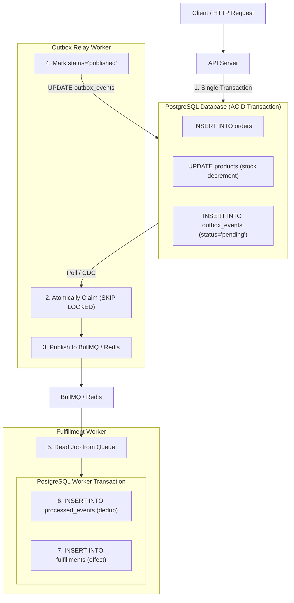

# 08 — An order committed, but its job disappeared (Transactional Outbox)

## Status and learning objective

This lab follows Sujan's engineering context: understand the mechanism, reproduce a failure, fix it, measure it, and defend the trade-offs. The stack is **TypeScript, NestJS, Raw PostgreSQL (`pg` connection pool), Redis, and BullMQ**. Zero ORM.

Your current capability: conditional inventory updates, PostgreSQL ACID transactions (`BEGIN/COMMIT/ROLLBACK`), Redis coordination, BullMQ jobs, and multi-instance workloads. 

The gap: **understanding what a local database transaction cannot protect when another external system (message queue, Redis, third-party API) is involved.**

After this lesson, explain and demonstrate this invariant:

> Every order accepted by the fixed demo has exactly one durable fulfillment intent committed alongside it in PostgreSQL. Delivery across the network may repeat; the local fulfillment effect occurs at most once per event.

Eventual completion additionally requires retained data, recovered dependencies, functioning workers, and intervention for permanent failures. This is not an end-to-end exactly-once delivery claim (which is mathematically impossible across arbitrary networks).

---

## 1. First, build the broken version

Business requirement: confirming an order must eventually create a fulfillment record, even if Redis is temporarily unavailable or an API process crashes.

Existing `src/order/order.service.ts::placeOrder` commits stock decrement and order creation inside a PostgreSQL transaction:
```sql
BEGIN;
UPDATE products SET stock = stock - $1, updated_at = now() WHERE sku = $2 AND stock >= $1 RETURNING *;
INSERT INTO orders (user_id, sku, quantity, status, unit_price_cents, total_cents, instance_id) VALUES (...) RETURNING *;
COMMIT;
```

The broken demonstration service (`src/order/order-outbox-demo.service.ts::placeBroken`) performs direct enqueueing after the database commit:

```ts
// 1. Order commits to Postgres inside its own local transaction
const result = await this.orderService.placeOrder(request);

// 2. Fault hook: simulate crash, power outage, or SIGKILL right after commit
if (request.fault === 'crash_after_commit') {
  throw new InternalServerErrorException('CRASH INJECTED [P1]: Process terminated after commit.');
}

// 3. Network write to external broker (Redis / BullMQ)
await this.fulfillmentQueue.add('order-confirmed', {
  eventId: randomUUID(),
  orderId: result.order.id,
});
return result;
```

The order's transaction has already finished before enqueueing. `try/catch`, `await`, or returning HTTP 500 cannot undo a committed PostgreSQL transaction.

### Enumerate the failure modes before reading the solution

| ID  | Problem statement and failure injection                                      | Broken outcome                                                             | Required solution                                                                       |
| --- | ---------------------------------------------------------------------------- | -------------------------------------------------------------------------- | --------------------------------------------------------------------------------------- |
| P1  | Crash after order commit, before enqueue.                                    | Stock decreases and order exists, but no fulfillment job exists.           | Commit the order and durable intent in one database transaction.                        |
| P2  | Redis is unavailable after order commit.                                     | Request can fail even though the order exists; queue has nothing to retry. | Accept based on the database commit and let a relay retry publication.                  |
| P3  | Reverse the operations: enqueue before committing the order; force rollback. | A worker can receive work for an order that never committed.               | Keep Redis writes outside the database transaction; publish committed intents only.     |
| P4  | Publish succeeds; relay crashes before recording success.                    | Recovery publishes the same event again.                                   | Stable event ID and durable consumer idempotency.                                       |
| P5  | Consumer commits the effect; worker crashes before acknowledging completion. | Queue recovery can execute the job again.                                  | Commit the deduplication receipt and effect together in PostgreSQL.                     |
| P6  | Two relay processes select the same pending record.                          | Duplicate publication and competing status updates.                        | Row-level lock: `SELECT ... FOR UPDATE SKIP LOCKED`, claim token, and expiring lease.    |
| P7  | Consumer rejects a malformed or unsupported event every time.                | Endless retries or silent abandonment.                                     | Validate payload/version, bound retries, retain failed work, alert, and support replay. |
| P8  | Incoming orders exceed publishing or processing capacity.                    | Backlog age grows, storage fills, and latency rises.                       | Bounded batches/concurrency, backlog metrics, capacity planning, and admission policy.  |
| P9  | Redis accepts a job and later loses it (OOM / non-persistent reboot).        | A `published` outbox row can exist without eventual fulfillment.           | Queue durability choices plus receipt-based reconciliation/replay of retained events.   |
| P10 | Client loses the HTTP response after commit and submits again.               | A second order can produce a second valid event.                           | Separate request-level idempotency; outbox event deduplication does not solve this.     |

---

## 2. Why the obvious fixes fail (Interview Deep-Dive)

Interviewers probe candidates with these naive solutions to test whether they understand system boundaries.

### Trap 1: "Why not wrap it in a `try/catch` and run a compensating action if `queue.add()` fails?"

```ts
// NAIVE CODE:
try {
  const result = await this.orderService.placeOrder(request);
  await this.queue.add('order-confirmed', { orderId: result.order.id });
} catch (err) {
  // Compensating action
  await this.orderService.cancelOrderAndRestoreStock(result.order.id);
  throw err;
}
```

* **Why it fails:** Compensating transactions are themselves fallible network operations. If the Node.js process suffers an unhandled exception, OOM kill, or container preemption between the order commit and the queue call, the `catch` block never executes. Furthermore, if PostgreSQL is temporarily degraded, the compensation query itself fails, leaving the system in a dual-failure state.
* **Interview Response:** *"Compensating transactions cannot guarantee consistency because the compensating write is itself subject to failure. In distributed systems, this is the dual-write problem: two independent state stores cannot be coordinated from application logic without distributed consensus protocols like 2PC, which introduce severe latency and availability bottlenecks."*

---

### Trap 2: "Why not reverse the order? Put `queue.add()` first, and then commit to the database."

```ts
// NAIVE CODE:
const eventId = randomUUID();
await this.queue.add('order-confirmed', { eventId, ... });
await this.orderService.placeOrder(request); // PostgreSQL transaction
```

* **Why it fails:** Reversing the order causes **ghost jobs** and **race conditions**.
  1. **Race condition:** Asynchronous workers consume from Redis immediately. A fast worker can pick up the job and query `SELECT * FROM orders WHERE id = $1` before the API server's database transaction has executed its `COMMIT`. The worker finds no order and either crashes or throws a false NotFound error.
  2. **Ghost jobs:** If the database transaction subsequently fails (e.g., out-of-stock check, serialization failure, constraint violation, connection drop), the database rolls back. However, the event is already in the queue and cannot be recalled from Redis. The worker fulfills an order that legally never existed.
* **Interview Response:** *"Reversing the order violates causality. Consumers can read the message before the database transaction commits (dirty read across systems). Furthermore, if the subsequent database commit rolls back due to a constraint or lock failure, an orphaned event has already been published to workers."*

---

### Trap 3: "Why not just put `await queue.add()` inside the PostgreSQL `BEGIN ... COMMIT` block?"

```ts
// NAIVE CODE:
const client = await this.pool.connect();
try {
  await client.query('BEGIN');
  await client.query('UPDATE products SET stock = stock - $1 ...');
  await client.query('INSERT INTO orders ...');

  // Network call to Redis inside SQL transaction:
  await this.queue.add('order-confirmed', { ... });

  await client.query('COMMIT');
} catch (err) {
  await client.query('ROLLBACK');
  throw err;
} finally {
  client.release();
}
```

* **Why it fails:**
  1. **Cross-boundary illusion:** PostgreSQL transactions only control PostgreSQL storage pages via the Write-Ahead Log (WAL). PostgreSQL has no protocol or authority over Redis sockets. If the `COMMIT` fails (network disconnect, disk full, deferred constraint violation), PostgreSQL rolls back the order, but Redis cannot roll back the job.
  2. **Connection and lock exhaustion:** Database connections and row locks (such as the `products` stock row) are scarce resources. Performing network I/O across a TCP socket inside a database transaction holds those locks open for the duration of the network round-trip. Under network jitter or Redis latency, connection pools exhaust immediately, cascading into system-wide API timeouts.
* **Interview Response:** *"A database transaction cannot roll back external socket side-effects. If `COMMIT` fails after `queue.add()` returns, the database rolls back but the message remains in flight. Additionally, holding database transactions and row locks open across external network I/O invites connection starvation and catastrophic concurrency degradation."*

---

## 3. The Actual Solution: Architecture & Implementation

### Core Invariant
> **Dual writes are eliminated by writing both the business entity and the dispatch intent into the same PostgreSQL storage engine in a single atomic transaction.**



---

### Step A: Write Order and Intent Together in PostgreSQL

```sql
-- DDL in db/init/001_schema.sql
CREATE TABLE IF NOT EXISTS outbox_events (
  event_id uuid PRIMARY KEY DEFAULT gen_random_uuid(),
  order_id bigint NOT NULL REFERENCES orders(id),
  type text NOT NULL,
  version smallint NOT NULL DEFAULT 1,
  occurred_at timestamptz NOT NULL DEFAULT now(),
  status text NOT NULL DEFAULT 'pending'
    CHECK (status IN ('pending', 'publishing', 'published', 'failed')),
  attempts smallint NOT NULL DEFAULT 0,
  available_at timestamptz NOT NULL DEFAULT now(),
  lease_until timestamptz,
  claim_token uuid,
  published_at timestamptz,
  last_error text,
  created_at timestamptz NOT NULL DEFAULT now()
);

-- Partial index for fast pending work polling
CREATE INDEX IF NOT EXISTS outbox_pending_idx
  ON outbox_events (status, available_at) 
  WHERE status IN ('pending', 'publishing');
```

Application transaction:
```ts
const client = await this.pool.connect();
try {
  await client.query('BEGIN');

  // 1. Reserve stock
  const product = await this.productService.reserveStockAtomically(sku, quantity, client);
  if (!product) throw new BadRequestException('Insufficient stock.');

  // 2. Insert order
  const { rows: [order] } = await client.query(
    `INSERT INTO orders (user_id, sku, quantity, status, unit_price_cents, total_cents, instance_id)
     VALUES ($1, $2, $3, 'confirmed', $4, $5, $6) RETURNING *`,
    [userId, sku, quantity, product.price_cents, product.price_cents * quantity, instanceId],
  );

  // 3. Insert outbox event in the SAME transaction
  const eventId = randomUUID();
  await client.query(
    `INSERT INTO outbox_events (event_id, order_id, type, version, status, available_at)
     VALUES ($1, $2, 'order.confirmed', 1, 'pending', now())`,
    [eventId, order.id],
  );

  await client.query('COMMIT');
  return { order, eventId };
} catch (err) {
  await client.query('ROLLBACK');
  throw err;
} finally {
  client.release();
}
```

---

### Step B: Relay Committed Records Using `SKIP LOCKED`

Multiple relay workers poll the outbox without clashing or blocking each other:

```sql
-- Atomic Claim Query
UPDATE outbox_events
SET status = 'publishing',
    claim_token = $1,
    lease_until = now() + interval '30 seconds',
    attempts = attempts + 1
WHERE event_id = (
  SELECT event_id
  FROM outbox_events
  WHERE (status = 'pending' AND available_at <= now())
     OR (status = 'publishing' AND lease_until < now())
  ORDER BY available_at ASC
  LIMIT 1
  FOR UPDATE SKIP LOCKED
)
RETURNING *;
```

After publishing to BullMQ:
```sql
-- Atomic Mark Published (with ownership check)
UPDATE outbox_events
SET status = 'published',
    published_at = now()
WHERE event_id = $1 
  AND status = 'publishing' 
  AND claim_token = $2;
```

---

### Step C: Consumer Idempotency via Unique Receipts

```sql
-- Deduplication receipt table
CREATE TABLE IF NOT EXISTS processed_events (
  consumer_name text NOT NULL,
  event_id uuid NOT NULL,
  processed_at timestamptz NOT NULL DEFAULT now(),
  PRIMARY KEY (consumer_name, event_id)
);

CREATE TABLE IF NOT EXISTS fulfillments (
  id bigserial PRIMARY KEY,
  order_id bigint NOT NULL UNIQUE REFERENCES orders(id),
  created_at timestamptz NOT NULL DEFAULT now()
);
```

Consumer transaction:
```ts
const client = await this.pool.connect();
try {
  await client.query('BEGIN');

  // 1. Attempt receipt insertion (deduplication gate)
  const receiptResult = await client.query(
    `INSERT INTO processed_events (consumer_name, event_id)
     VALUES ($1, $2)
     ON CONFLICT (consumer_name, event_id) DO NOTHING
     RETURNING *`,
    ['fulfillment-consumer-v1', job.data.eventId],
  );

  // If row was not inserted, it was already processed!
  if (receiptResult.rowCount === 0) {
    await client.query('ROLLBACK');
    this.logger.warn(`Duplicate event ${job.data.eventId} suppressed.`);
    return; // Acknowledge job as successful no-op
  }

  // 2. Perform business effect in the same transaction
  await client.query(
    `INSERT INTO fulfillments (order_id) VALUES ($1)`,
    [job.data.orderId],
  );

  await client.query('COMMIT');
} catch (err) {
  await client.query('ROLLBACK');
  throw err; // Allow BullMQ retry
} finally {
  client.release();
}
```

---

## 4. Staff Engineer Questions & Answers (Interview Reference)

Use these detailed answers for system design interviews and architectural reviews.

### 1. Why can't a database transaction roll back a message queue job?
A database transaction guarantees ACID within its own storage engine by appending records to its Write-Ahead Log (WAL) and releasing row/table locks upon `COMMIT` or `ROLLBACK`. External brokers like Redis or Kafka communicate over independent TCP sockets outside the database engine. Once network bytes are transmitted and acknowledged by the broker, the database engine has no protocol (such as two-phase commit) to retract those bytes if a subsequent database error occurs.

### 2. Why publish before marking `published`, even though it allows duplicates?
In distributed systems, you must choose between **at-least-once delivery** (duplicates possible) and **at-most-once delivery** (data loss possible). 
- If you mark `status = 'published'` *before* publishing, a crash during publication means the row is marked complete but was never sent—resulting in **silent, permanent message loss**.
- If you publish *first* and crash before updating the outbox row, the relay will re-deliver the message upon recovery. Because downstream consumers implement idempotent deduplication (via `processed_events`), duplicates are safely absorbed, guaranteeing zero data loss.

### 3. What happens if the consumer commits before the relay marks `published`?
This is completely normal and safe in an asynchronous system. The consumer successfully writes the receipt and fulfillment record to PostgreSQL and acknowledges the BullMQ job. If the relay then crashes before updating the outbox row, the relay will eventually recover, re-claim the row via lease expiry, and publish a duplicate message. When the consumer receives the duplicate, its `INSERT INTO processed_events ON CONFLICT DO NOTHING` gate detects the existing receipt and cleanly discards the duplicate with zero side-effects.

### 4. How does a crashed relay's claim become recoverable? Why does a lease not eliminate duplicate publication?
- **Recovery:** When a relay claims a row, it sets a lease deadline (`lease_until = now() + interval '30s'`). If the relay crashes, the lease expires. The polling query specifically searches for `status = 'pending' OR (status = 'publishing' AND lease_until < now())`, allowing surviving relays to reclaim orphaned rows.
- **Why leases cannot eliminate duplicates:** If a relay encounters an unexpected 45-second process pause (such as a full garbage collection cycle or network freeze), its 30-second lease expires while it is still working. Another relay claims the row and publishes it. When the first relay unfreezes, it also publishes. Both publish the message. This is why leases only provide fault-tolerant concurrency coordination, not distributed uniqueness. Uniqueness must be enforced at the consumer.

### 5. Why must the deduplication receipt and local effect share a transaction?
If receipt insertion and the business effect (fulfillment) are in separate transactions, a crash between them causes inconsistency:
- Effect first, receipt second: Crash before receipt write results in duplicate fulfillment on retry.
- Receipt first, effect second: Crash before effect write results in the event being permanently ignored as a "duplicate", leaving fulfillment unexecuted.
Coupling them in a single `BEGIN ... COMMIT` block guarantees that either **both** exist or **neither** exists.

### 6. Why does a stable `jobId` in BullMQ stop helping after job retention expires?
BullMQ uses Redis keys to track existing job IDs (`bull:queue:id`). To conserve Redis memory, finished jobs are evicted according to removal policies (e.g. `removeOnComplete: { age: 3600, count: 1000 }`). Once a job is evicted from Redis, BullMQ no longer knows it ever existed. A re-published event with the same ID will be treated as a brand new job. Therefore, deduplication in Redis is merely an optimization; the **durable source of truth for idempotency must reside in the database (`processed_events`)**.

### 7. What distinguishes request idempotency, event idempotency, and provider idempotency?
- **Request Idempotency:** Protects the boundary between the client (browser/mobile app) and the API gateway. Keyed by a client-supplied `Idempotency-Key` header to handle client HTTP retries.
- **Event Idempotency:** Protects internal asynchronous consumer pipelines against queue retries and relay re-deliveries. Keyed by a durable domain `event_id` in `processed_events`.
- **Provider Idempotency:** Protects outbound calls from your workers to external third-party APIs (e.g., Stripe `idempotency_key`, shipping provider booking keys) where your system cannot rollback third-party state.

### 8. How do you detect a published event that never produced its effect?
Via an asynchronous **Reconciliation Sweeper**:
A periodic background cron job runs a relational query looking for anomalies:
```sql
SELECT o.event_id, o.order_id, o.occurred_at
FROM outbox_events o
LEFT JOIN fulfillments f ON o.order_id = f.order_id
WHERE o.status = 'published'
  AND o.published_at < now() - interval '15 minutes'
  AND f.id IS NULL;
```
If an outbox event was marked `published` 15+ minutes ago but no fulfillment record exists in the database, the job was either lost in the message broker or permanently stalled in a dead-letter queue. The sweeper alerts on-call engineers and triggers controlled replay.

### 9. What happens when the order arrival rate exceeds the processing rate for an hour?
1. The `outbox_events` table accumulates un-dispatched rows, increasing the metric `oldest_pending_age_seconds` and table size.
2. The index scan on `outbox_pending_idx` remains fast because it is a partial index indexing only active rows (`status IN ('pending', 'publishing')`).
3. If database write I/O saturates, ingestion latency degrades for checkout requests.
4. Mitigation requires:
   - Increasing relay batch size and concurrency.
   - Scaling worker consumers horizontally.
   - Implementing admission control / rate limiting at the API gateway before database storage or connection limits are breached.

### 10. Which guarantee would change if fulfillment became a real external shipping API?
With an external third-party shipping API (e.g. FedEx, DHL), you **cannot enlist their system in your PostgreSQL ACID transaction**. 
The local transaction can only record your intent to call the external API. The worker must pass a deterministic idempotency key derived from the `event_id` to the external shipping API. If the network call times out, the worker must query the shipping API's status endpoint to reconcile whether the label was booked before deciding to retry. Exactly-once execution becomes dependent on the external provider's idempotency contract.
